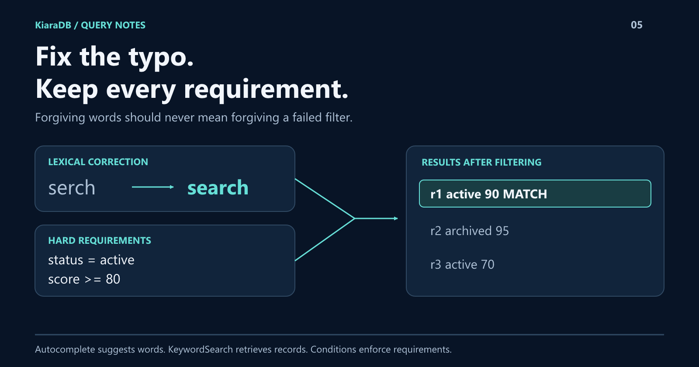

# Fix the Typo, Keep the Filter: Better Text Search with KiaraDB

A misspelled word should not hide a useful result. A hard requirement should not disappear with it.
KiaraDB combines lexical search with structured conditions: correct the word, then return only qualifying records.
You will build that behavior and separate it from autocomplete, so a suggested word never gets mistaken for a matching record.



## Forgiving input, strict requirements

Search assistance and filtering solve different problems.

Prefix completion helps users finish a word. Typo correction recovers a small
mistake. English stemming connects related word forms. Structured conditions
enforce requirements such as an active status or minimum score.

Putting them together is useful precisely because they retain their separate
contracts. Correcting a keyword is not permission to relax a numeric bound.

## A complete example

Install `@kapoorlabs/kiara-ts@1.1.0`, save the following as `text-search.mjs`,
and run `node text-search.mjs`. The records are fictional; this is a behavior
demonstration, not a speed test.

The same output was verified on **1.1.1-search.0**, the optimized candidate behind
[the 1.2.0 GitHub release](https://github.com/kapoorlabs/kiara-ts/releases/tag/v1.2.0).
Its release notes report npm publication blocked, so the install remains 1.1.0.
These are TypeScript keyword semantics, not a promise of identical Java results.

```javascript
import {
  Store, NormalizationProfile, DictionaryTrie, KeywordSearch, Operator,
  createCondition, defineSchema, textField, numberField,
} from "@kapoorlabs/kiara-ts";

const store = new Store(defineSchema([
  textField("id", { ignoreIndex: true }),
  textField("title", { stemmedIndex: true, oneEditAway: true }),
  textField("status"),
  numberField("score"),
]), { normalizationProfile: NormalizationProfile.NATIVE });
store.loadRows([
  { id: "r1", title: "Search guide", status: "active", score: 90 },
  { id: "r2", title: "Search reference", status: "archived", score: 95 },
  { id: "r3", title: "Search notes", status: "active", score: 70 },
]);
store.prepare();

const dictionary = new DictionaryTrie();
for (const row of store.queryAll()) dictionary.addText(row.title);

const search = new KeywordSearch(store);
const options = {
  fields: ["title"],
  conditions: [
    createCondition({ field: "status", values: ["active"] }),
    { field: "score", operator: Operator.GREATER_THAN_EQUAL, values: [80] },
  ],
  limit: 10,
};
const result = search.bestMatch("serch", options);
if (result.truncated) throw new Error("Keyword input was truncated.");

console.log(JSON.stringify({
  suggestions: dictionary.predict("sea", 5),
  corrected: result.correctedKeywords,
  ids: result.results.map((row) => row.id),
  stemmedIds: search.bestMatch("searching", options).results.map((row) => row.id),
}));
```

Expected output:

```json
{"suggestions":["search"],"corrected":{"serch":"search"},"ids":["r1"],"stemmedIds":["r1"]}
```

All three titles contain the word. Only `r1` satisfies both hard conditions.
The correction helps discovery without admitting the archived or lower-scored row.

## Suggestions are not results

`DictionaryTrie.predict` returns words. `KeywordSearch.bestMatch` returns records
and matching metadata.

For autocomplete, try prefix predictions first. If none exist, the dictionary's
`getOneEditCandidate` can provide a correction candidate. It supports one
insertion, deletion, or substitution, not a transposition, and does not correct
inputs of three characters or fewer.

Build dictionaries once and reuse them. Separate dictionaries can scope
suggestions to a particular field. Selecting a suggestion should trigger a
separate record query.

The companion application's final-word completion and keyboard controls are UI
logic, not a ready-made component shipped by the database.

The dictionary also cannot suggest vocabulary absent from the source records.
Improving the data and choosing appropriate fields remain part of building
useful search.

## Know what the keyword score means

TypeScript `bestMatch` selects the highest positive query-token-match group.
It does not guarantee that every input word occurs.

`minimumMatch` selects the lowest positive group. Despite its name, it is not
"at least this many matches" and should not be used as an automatic policy
precedence engine.

Use structured conditions for mandatory requirements. The keyword APIs are
lexical retrieval, not semantic understanding or an intent classifier.

## Make the assistance visible

The response includes used keywords, matched keywords, corrections, and a
truncation indicator.

Use that metadata to explain a correction or warn that an input exceeded the
keyword cap. The default cap is ten distinct keywords; the default keyword
result limit is 100. A bounded response is not a total-count measurement.

Stemming is opt-in for appropriate fields. It connects English word forms,
not arbitrary concepts or every language.

## One useful search experience, several clear contracts

The practical gain is not one magical search call. It is a predictable pipeline:
suggest words, retrieve candidates, enforce conditions, and explain the result.

Try **Typo-tolerant keyword search** and **Airport type-ahead** in the
[examples playground](https://github.com/kapoor-labs/kiara-ts-examples).
The samples differ; the interaction works with the vocabulary in your own data.
