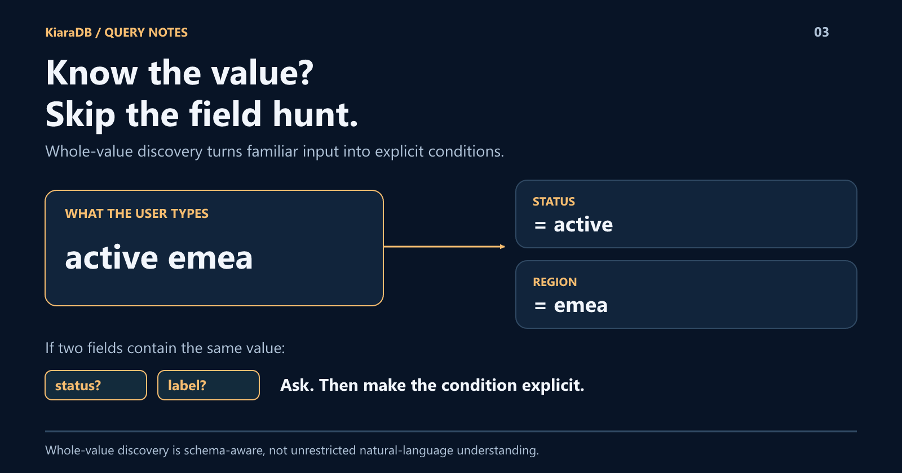

# Type the Value. Let KiaraDB Find the Field.

Your user remembers "active" and "emea," not your column names.
Why require two dropdowns before they can ask for the right records?
KiaraDB's TypeScript query interpreter can discover whole values across eligible fields and turn them into explicit filters.
The useful twist: when more than one field fits, it asks rather than guessing.



## Start with what the user knows

Suppose your prepared data has a `status` field containing `active` and a
`region` field containing `emea`. If those values resolve uniquely, typing:

```text
active emea
```

produces a status condition and a region condition, combined with AND.

The interpreter uses observed whole values, not a model inventing the user's
intent. Eligible fields are searchable text, enum, number, boolean, and
comma-separated string fields.

## Mix discovery with precision

The user can be explicit when needed:

```text
active score>=80
```

Now a discovered status and an exact numeric bound work together.

Declared field aliases and value aliases let the application accept familiar
vocabulary without renaming its stored records. Unit metadata can also make
equivalent quantities resolve consistently.

Those mappings are configuration, not automatic knowledge of every domain.

## A question beats a wrong answer

What if both `status` and `label` contain `active`?

The interpreter returns candidate fields. Your UI can ask the user to choose,
then make the condition explicit.

Unknown or invalid input is different from a valid query with no matches.
The strict search path rejects unresolved interpretations rather than applying
only the fragments it understood.

## Show users what happened

Resolved fragments include their conditions and source positions.
Applications can use those to build editable chips, remove a clause, or keep
typed input synchronized with traditional controls.

KiaraDB supplies interpretation and fragment-editing helpers; your application
supplies the interface.

**The gain is not "AI search." It is a shorter path to precise filters.**

See **Filterless Parts Finder** in the
[examples playground](https://github.com/kapoor-labs/kiara-ts-examples).
The sample data is domain-specific; the interaction pattern is not.
Adapt the schema, aliases, and units to the records your users already know.
