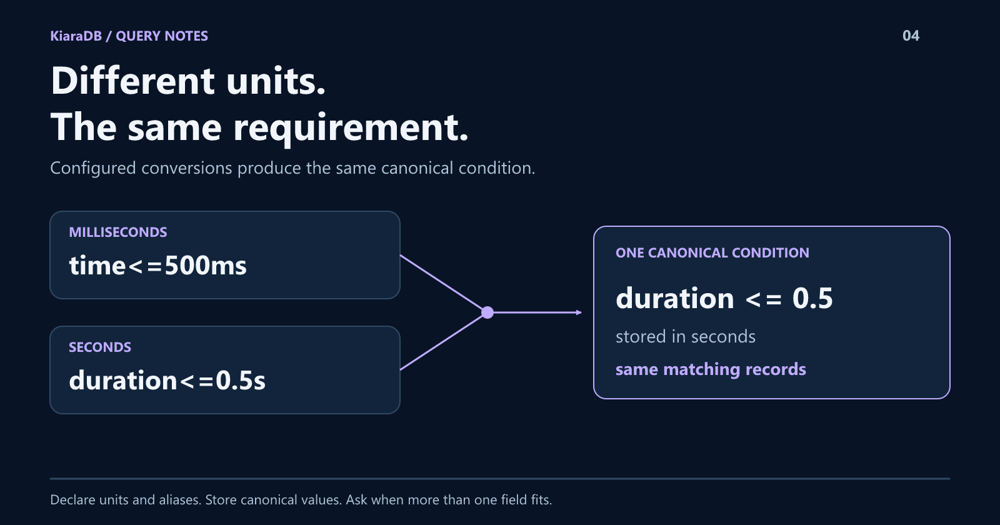

# 500ms or 0.5s? Make Equivalent Queries Return the Same Results.

Two people express the same requirement in different units. Your search should not give them different answers.
KiaraDB's TypeScript interpreter converts declared units into canonical conditions, while preserving exact comparisons and exposing ambiguity.
You will build a query that treats `500ms` and `0.5s` alike, then see what happens when a value could mean two different fields.



## Normalize meaning, not just spelling

This problem appears whenever a numeric field has units. Converting text to a
number is not enough: `500` and `0.5` differ unless you know what they measure.

The application must declare that knowledge. KiaraDB's `QueryInterpreter` uses
field metadata to convert input into the unit used by stored records.

It is a deterministic conversion, not a language model inferring dimensions.
The same interpreter can resolve field aliases, discover whole values, and
produce inspectable conditions.

## Declare the conversion once

This example uses TypeScript package **1.1.0** through JavaScript. Install
`@kapoorlabs/kiara-ts@1.1.0`, save the code as `unit-search.mjs`, and run
`node unit-search.mjs`.

The output was also verified on the optimized **1.1.1-search.0** candidate behind
[1.2.0 on GitHub](https://github.com/kapoorlabs/kiara-ts/releases/tag/v1.2.0).
Its release notes report npm publication blocked; keep the install pin above.

The fictional records store both duration fields in seconds.

```javascript
import {
  Store, NormalizationProfile, QueryInterpreter,
  defineSchema, textField, numberField,
} from "@kapoorlabs/kiara-ts";

const store = new Store(defineSchema([
  textField("id", { ignoreIndex: true }),
  numberField("duration"),
  numberField("backupDuration"),
]), { normalizationProfile: NormalizationProfile.NATIVE });
store.loadRows([
  { id: "a", duration: 0.4, backupDuration: 0.2 },
  { id: "b", duration: 0.7, backupDuration: 1 },
]);
store.prepare();

const units = { canonicalUnit: "s", units: { s: 1, ms: 0.001 } };
const interpreter = new QueryInterpreter(store, {
  fields: {
    duration: { ...units, aliases: ["time"] },
    backupDuration: units,
  },
});
const ids = (input) => interpreter.search(input).map((row) => row.id);

console.log(JSON.stringify({
  milliseconds: ids("time<=500ms"),
  seconds: ids("duration<=0.5s"),
  range: ids("duration:200ms..500ms"),
  bareValue: interpreter.interpret("500ms").issues[0].kind,
}));
```

Expected output:

```json
{"milliseconds":["a"],"seconds":["a"],"range":["a"],"bareValue":"ambiguous"}
```

The alias `time` maps to `duration`. Both upper bounds become half a second.
Each endpoint of the inclusive range is converted independently.

There is no manually defined index for each unit or alias. Those expressions
compile into conditions over the same prepared numeric field.

## Why the last query asks a question

`500ms` could refer to `duration` or `backupDuration`.

The unit identifies possible fields, not the user's intention. Both are
candidates even when the current dataset has no exact half-second value.
A bare value means equality; it must not silently become "at most."

Use `interpret()` to show candidates, ask for a field selection, and display
the resulting condition. The strict `search()` path throws if unresolved issues
remain. A valid query returning no rows is a separate, ordinary outcome.

This matters more than making every input appear successful. A partial answer
can look convincing while ignoring the user's actual requirement.

## Turn the interpretation into an editable interface

Interpretation returns resolved filters with source spans, plus invalid,
unrecognized, or ambiguous fragments.

Your application can render those filters as chips. `editQueryFragment` changes
or removes a fragment in the original input; reinterpret after editing because
source offsets belong to that version of the query.

That also makes it possible to keep dropdowns and typed input connected to one
query state rather than two competing sets of filters.

## Keep the contract precise

- Store records in the declared canonical unit; the interpreter converts input,
  not the source dataset.
- Use NATIVE normalization for unit-aware numeric fields.
- Unit factors are explicit positive multipliers. This is not a universal unit registry.
- Put units on both range endpoints when needed; units do not inherit across bounds.
- Final values are JavaScript numbers, not arbitrary-precision decimal arithmetic.
- Keep expressions contiguous: `duration<=500ms`, not `duration <= 500 ms`.

Dates and stored interval fields use the structured query APIs, not this
interpreter grammar. Build a new interpreter when the store snapshot changes.

## Less input friction, without less precision

Users should not need to remember your column names and preferred units before
they can search. They should be able to see exactly how their input was resolved.

Explore the editable-query interaction in **Filterless Parts Finder** in the
[companion playground](https://github.com/kapoor-labs/kiara-ts-examples).
Its domain-specific dataset is only an example; the unit and alias configuration
belongs to your schema.
