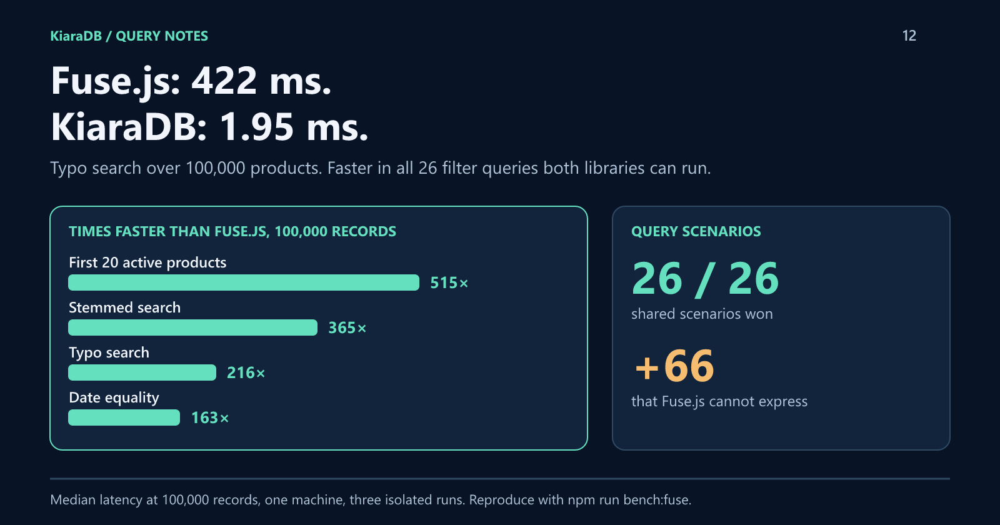

# Meet KiaraDB: Client-Side Search Up to 500× Faster Than Fuse.js. It's Not Even Close.

KiaraDB is an open-source, in-memory search engine for TypeScript and Java that runs in the browser or on the server. Over 100,000 products, it answered a misspelled search in 1.95 ms. Fuse.js, the popular fuzzy-search library, needed 422 ms.
That was no outlier: KiaraDB won all 26 filter queries both libraries can run, by up to 515×, then handled 66 more that Fuse.js cannot express.


*Written by KiaraDB's creator with AI assistance. Every number comes from an open benchmark you can rerun with one command.*

## Search that does its homework first

Most JavaScript search libraries, Fuse.js included, work at query time: every search walks every record and scores it. That is simple, and it gets slower with every record you add.

KiaraDB flips the order. You declare your fields, load your records, and prepare once. Every field gets its own index, and a query combines only the indexes it needs. Ask for any five of a hundred fields, in any combination, and KiaraDB answers from its indexes, with no composite index declared in advance.

From that one design you get:

- **Any combination of filters:** equality, exclusions, numbers, dates, date-times, and missing values.
- **Multi-value search:** match records containing *any* (`CONTAINS_EITHER`) or *all* (`CONTAINS_ALL`) of several values in a list field, such as tags, sizes, or prices.
- **Stored ranges:** price bands, availability windows, or opening seasons, queried with "which of these contain July 15?"
- **Typo-tolerant keyword search** that reports what it corrected, plus English stemming and minimum-match search.
- **As-you-type completion** from the words actually in your data.
- **A query interpreter:** users type values such as `porto` or `active emea`, and KiaraDB works out which fields they belong to.
- **The same engine in TypeScript and Java.**

## One store, six kinds of search

```javascript
import {
  Store, NormalizationProfile, Operator, KeywordSearch, QueryInterpreter, DictionaryTrie,
  createCondition, defineSchema, textField, numberField,
} from "@kapoorlabs/kiara-ts";

const store = new Store(defineSchema([
  textField("city", { caseInsensitive: true }),
  numberField("price"),
  textField("season", { secondaryType: "dateRange" }),
  textField("title", { caseInsensitive: true, stemmedIndex: true }),
  textField("id", { ignoreIndex: true }),
]), { normalizationProfile: NormalizationProfile.NATIVE });
store.loadRows([
  { city: "Lisbon", price: 120, season: "2026-06-01->2026-09-30", title: "Rooftop Jazz Concerts", id: "e1" },
  { city: "Lisbon", price: 45, season: "2026-07-01->2026-07-31", title: "Street Food Tour", id: "e2" },
  { city: "Porto", price: 60, season: "2026-05-01->2026-10-31", title: "River Wine Tasting", id: "e3" },
]);
store.prepare();

const ids = (rows) => rows.map((row) => row.id);
const keywords = new KeywordSearch(store);
const words = new DictionaryTrie();
for (const row of store.queryAll()) words.addText(row.title);

const typo = keywords.bestMatch("jazz concrts", { fields: ["title"] });
console.log(JSON.stringify({
  // City, a stored date range, and a price bound, with no index declared for the combination.
  cheapInJuly: ids(store.search([
    createCondition({ field: "city", values: ["lisbon"] }),
    { field: "season", operator: Operator.CONTAINS_EITHER, values: ["2026-07-15"] },
    { field: "price", operator: Operator.LESS_THAN, values: [100] },
  ])),
  typo: ids(typo.results),
  corrected: typo.correctedKeywords,
  stemmed: ids(keywords.bestMatch("tours", { fields: ["title"] }).results),
  typeahead: words.predict("ro", 3),
  byValue: ids(new QueryInterpreter(store).search("porto")),
}));
```

```json
{"cheapInJuly":["e2"],"typo":["e1"],"corrected":{"concrts":"concerts"},"stemmed":["e2"],"typeahead":["rooftop"],"byValue":["e3"]}
```

Structured filters, a stored date range, typo correction, stemming, completion, and value-only search, all from one prepared store.

## Against Fuse.js, it's not a contest

Fuse.js is the go-to fuzzy-search library for JavaScript, so it is the natural yardstick. The benchmark ran both on five datasets, up to 100,000 records, with three isolated runs each. Median latency at 100,000 records, against the faster of two Fuse.js configurations:

| Query | KiaraDB | Fuse.js | KiaraDB is |
|---|---:|---:|---:|
| First 20 active products | 0.15 ms | 75 ms | 515× faster |
| Stemmed search "chargers", top 10 | 1.0 ms | 363 ms | 365× faster |
| Typo search "wireles lamp", top 10 | 1.95 ms | 422 ms | 216× faster |
| One date equal (292 matches) | 0.28 ms | 45 ms | 163× faster |
| Three fields equal (299 matches) | 0.37 ms | 47 ms | 128× faster |
| Contains all of two tags (981 matches) | 3.2 ms | 40 ms | 12× faster |



KiaraDB won every one of the 26 exact scenarios Fuse.js can express, on every dataset, averaging 24× to 65× faster per dataset. Even its narrowest win, two broad conditions matching 17,605 records, went to KiaraDB.

Then come the other 66 scenarios. Fuse.js compares strings, so it has no way to ask for prices under 100, dates between two days, seasons that contain July 15, or records with a missing value. KiaraDB answers all of them.


## Fast and correct

Speed means nothing with wrong answers. Each of the 92 exact scenarios is checked against an independent implementation, and a single wrong record fails the run. KiaraDB passed every one.

Text search showed the same pattern. On `wireles lamp`, all 10 of KiaraDB's results contained both words. Default Fuse.js returned none that did; it needed tuning to recover, and was still 216 times slower.

## What the speed costs

KiaraDB does its work up front. At 100,000 records it took 4.3 seconds and 489 MB to build, against 0.27 seconds and 110 MB for Fuse.js. Data is a prepared snapshot, so changes mean a rebuild, and typo correction fixes one letter per word, where Fuse.js tolerates more.

The trade pays off fast. Each typo search saves about 420 ms, so the slower build is repaid after roughly ten searches. Catalogs, inventories, schedules, and reference data are built once and queried thousands of times. For data that changes every second, or very loose fuzzy matching, Fuse.js remains a good fit.

## Try it

```bash
npm install @kapoorlabs/kiara-ts
```

Rerun the benchmark yourself:

```bash
git clone https://github.com/kapoor-labs/kiara-ts-examples
cd kiara-ts-examples && npm install && npm run bench:fuse
```

The [full report](https://github.com/kapoor-labs/kiara-ts-examples/blob/main/docs/fuse-comparison.md) lists every scenario and the method. Results come from one machine with mostly synthetic data, measured on [kiara-ts 1.2.0](https://github.com/kapoorlabs/kiara-ts/releases/tag/v1.2.0).

KiaraDB is open source for [TypeScript](https://github.com/kapoorlabs/kiara-ts) and [Java](https://github.com/kapoorlabs/kiara).
