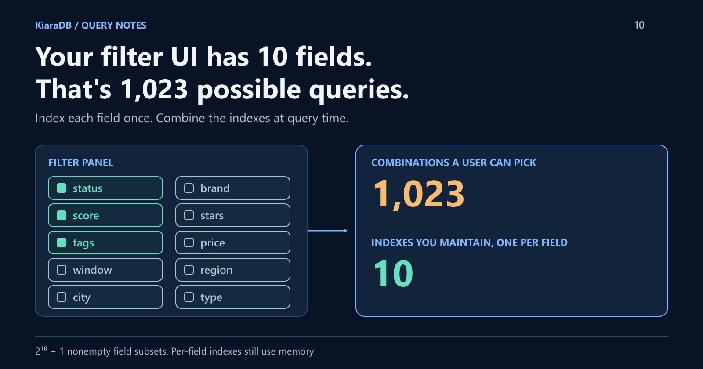
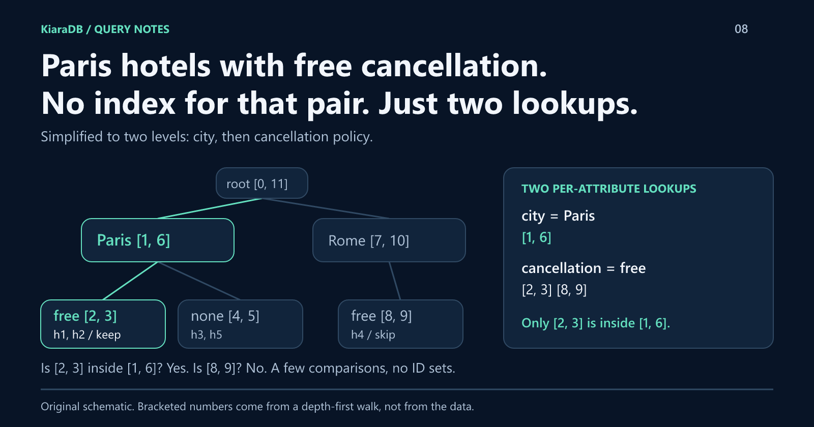

# Your Filter UI Has 10 Fields. That's 1,023 Possible Queries.

Every field you add to a filter panel doubles the combinations users can pick. You can't build an index for each one, and scanning every record slows down as data grows.
This tutorial shows the alternative I use: index each field once, then combine them at query time with a numbered tree. You'll even build the core trick yourself.

*Disclosure: This article was drafted with AI assistance.*



*Technical illustration created with AI assistance.*

## Same wall, two companies

I first hit this problem at a global travel company, and again at a global
e-commerce company. Records carried many attributes, every new feature asked
for a different combination of them, and answers had to fit inside a
user-facing request. The data changed rarely; the questions changed constantly.

## The math: every field doubles the work

With `n` independent filter fields, users can pick `2^n - 1` nonempty
combinations:

| Filter fields | Possible combinations |
|---:|---:|
| 5 | 31 |
| 10 | 1,023 |
| 20 | 1,048,575 |

A dedicated lookup per combination is out. So is a full scan per request if
the dataset is large and the budget is a few milliseconds.

## The obvious fix, and where it hurts

The standard answer is **one index per field**, then intersecting the matching
ID sets. Ten fields, ten indexes. Done?

Mostly. The catch is that intersection cost follows the size of each matched
list, not the size of the answer. If `status = active` matches 70% of a million
records and `score >= 80` matches 50%, you build and compare hundreds of
thousands of IDs to return a handful.

What I wanted was per-field indexes that can be combined **without building
large ID sets**. That became **KiaraDB**, an in-memory engine for read-mostly
data, available for Java and TypeScript.

## The idea in two sentences

Store records as paths in a tree, so records that share leading values share
nodes. Number every node during a depth-first walk, so "is this node underneath
that one?" becomes two integer comparisons, which is all you need to combine
conditions from different field indexes.

## Run it: one prepared store, many filter combinations

Install `@kapoorlabs/kiara-ts@1.1.0` from npm, save this as
`composable-search.mjs`, and run `node composable-search.mjs`. Each fictional row
fails for a different reason:

```javascript
import assert from "node:assert/strict";
import {
  Store, NormalizationProfile, Operator,
  createCondition, defineSchema, textField, numberField,
} from "@kapoorlabs/kiara-ts";

const rows = [
  { status: "active", score: 85.5, tags: "audited,export", window: "10->30", id: "a" },
  { status: "active", score: 91.25, tags: "export", window: "10->30", id: "b" },
  { status: "archived", score: 90, tags: "audited,export", window: "10->30", id: "c" },
  { status: "active", score: 79, tags: "audited,export", window: "10->30", id: "d" },
  { status: "active", score: 90, tags: "audited,export", window: "21->30", id: "e" },
  { status: "active", score: 90, tags: "audited,export,blocked", window: "10->30", id: "f" },
];
const store = new Store(defineSchema([
  textField("status", { caseInsensitive: true }),
  numberField("score"),
  textField("tags", { secondaryType: "commaSeparatedStrings" }),
  textField("window", { secondaryType: "numericRange" }),
  textField("id", { ignoreIndex: true }),
]), { normalizationProfile: NormalizationProfile.NATIVE });
store.loadRows(rows);
store.prepare();

const common = [
  createCondition({ field: "status", values: ["ACTIVE"] }),
  { field: "score", operator: Operator.BETWEEN, lowerValue: 80.5, upperValue: 95.5 },
  { field: "tags", operator: Operator.NOT_CONTAINS, values: ["blocked"] },
  { field: "window", operator: Operator.CONTAINS_EITHER, values: [20] },
];
const required = ["audited", "export"];
const allTags = store.searchProjection([
  ...common,
  { field: "tags", operator: Operator.CONTAINS_ALL, values: required },
], ["id", "score"]);
const eitherTag = store.searchProjection([
  ...common,
  { field: "tags", operator: Operator.CONTAINS_EITHER, values: required },
], ["id", "score"]);

const reference = rows.filter((row) => {
  const tags = row.tags.split(",");
  const [lower, upper] = row.window.split("->").map(Number);
  return row.status.toLowerCase() === "active"
    && row.score >= 80.5 && row.score <= 95.5
    && !tags.includes("blocked")
    && lower <= 20 && 20 <= upper
    && required.every((tag) => tags.includes(tag));
}).map(({ id, score }) => ({ id, score }));

assert.deepEqual(allTags, reference);
console.log(JSON.stringify({ allTags, eitherTag, agreesWithScan: true }));
```

```json
{"allTags":[{"id":"a","score":85.5}],"eitherTag":[{"id":"a","score":85.5},{"id":"b","score":91.25}],"agreesWithScan":true}
```

The assertion checks the indexed query against a plain JavaScript filter first.

`a` passes everything. `b` lacks `audited`, so it
appears only when the tag rule switches from ALL to ANY. `c` is archived, `d`
scores too low, `e`'s window starts after 20, and `f` carries the excluded
`blocked` tag.

Notice what did **not** happen between the two queries: no new index, no
second `prepare()`, no reload. Details worth knowing:

- Conditions combine with **AND**; ALL and ANY apply to the tag values only.
- `BETWEEN` includes both bounds, and the window check asks whether a stored
  range contains the point `20`.
- Fields become tree levels in schema order. Put low-variety fields first and
  unique IDs last, so early levels share more nodes.
- `ignoreIndex` keeps `id` out of filtering while projections still return it.
- `NATIVE` keeps decimals such as `85.5` intact; the default profile mirrors
  the Java library's integer keys.

## Build the core trick yourself

The algorithm comes from my 2020 paper,
[Efficient Storage and Retrieval of In-Memory Static Data](https://journal.ut.ac.ir/article_76227_7508c12200be2eb3f9f16a97aac23a44.pdf).
Here is a stripped-down version you can run: two fields, equality only.

```javascript
const hotels = [
  { city: "Paris", cancellation: "free", id: "h1" },
  { city: "Paris", cancellation: "free", id: "h2" },
  { city: "Paris", cancellation: "none", id: "h3" },
  { city: "Rome", cancellation: "free", id: "h4" },
  { city: "Paris", cancellation: "none", id: "h5" },
];
const fields = ["city", "cancellation"];

// 1. Records become paths; equal leading values share a node.
const root = { children: new Map(), ids: [] };
for (const hotel of hotels) {
  let node = root;
  for (const field of fields) {
    const value = hotel[field];
    if (!node.children.has(value)) {
      node.children.set(value, { field, value, children: new Map(), ids: [] });
    }
    node = node.children.get(value);
  }
  node.ids.push(hotel.id);
}

// 2. A depth-first walk numbers every node.
// 3. Each field gets one index: value -> nodes, already sorted by start.
let clock = 0;
const index = new Map(fields.map((field) => [field, new Map()]));
(function walk(node) {
  node.start = clock++;
  if (node.field) {
    const byValue = index.get(node.field);
    if (!byValue.has(node.value)) byValue.set(node.value, []);
    byValue.get(node.value).push(node);
  }
  for (const child of node.children.values()) walk(child);
  node.end = clock++;
})(root);

// 4. Combine two conditions: keep descendants inside an ancestor's range.
function within(ancestors, descendants) {
  const result = [];
  for (const ancestor of ancestors) {
    let low = 0;
    let high = descendants.length;
    while (low < high) {
      const mid = (low + high) >> 1;
      if (descendants[mid].start < ancestor.start) low = mid + 1;
      else high = mid;
    }
    for (let i = low; i < descendants.length && descendants[i].start < ancestor.end; i++) {
      result.push(descendants[i]);
    }
  }
  return result;
}

const paris = index.get("city").get("Paris");
const free = index.get("cancellation").get("free");
console.log(JSON.stringify({
  paris: paris.map((node) => [node.start, node.end]),
  free: free.map((node) => [node.start, node.end]),
  result: within(paris, free).flatMap((node) => node.ids),
}));
```

```json
{"paris":[[1,6]],"free":[[2,3],[8,9]],"result":["h1","h2"]}
```

The same tree, with the numbers your code just printed:



The city index returned one node, `[1, 6]`. All Paris hotels sit under it,
instead of in a list of IDs. The cancellation index returned two nodes, and
binary search found that only `[2, 3]` sits inside `[1, 6]`. Rome's branch was
never read, and nothing was built for "city + cancellation."

The real engine generalizes this. Either list can be the shorter one, numeric
fields use sorted keys with binary-searched bounds, stored ranges use interval
trees, and limited queries stop early in source order.

## Does it beat intersecting ID sets?

I can compare both strategies within one library. An earlier TypeScript engine
kept one index per field but merged results as ID sets, rechecked candidates,
and scanned numeric and range entries linearly. The current tree engine ships
in [kiara-ts 1.2.0](https://github.com/kapoorlabs/kiara-ts/releases/tag/v1.2.0),
currently on GitHub rather than npm.

Synthetic 100,000-record dataset, four fields, Node 24, five isolated runs per
engine, median p95:

| Query | ID-set engine | Tree engine |
|---|---:|---:|
| Equality, one result | 16.6 ms | 0.014 ms |
| Two fields combined, 2 results | 21.3 ms | 0.032 ms |
| Exclusion, first 100 results | 36.6 ms | 8.8 ms |
| Every record returned | 90.3 ms | 39.0 ms |
| Keyword search, warm cache | 490.5 ms | 27.3 ms |

Selective queries dropped far below a millisecond; queries returning many
records improved less because those records still have to be assembled.
Prepared memory was about 14% lower than the ID-set engine; after warming the
keyword caches, it was about 7% higher. [The benchmark report](https://github.com/kapoorlabs/kiara-ts/blob/v1.2.0/docs/search-execution.md)
has the method and raw runs.

These numbers compare two versions of one library, not every intersection
strategy. To evaluate it yourself, measure preparation separately from
queries, include broad queries alongside selective ones, check memory while
swapping snapshots, and verify results against a trusted baseline.

## When to reach for it

Reach for it when data is **read-mostly**, fits in memory, has **many fields**,
and users combine them **unpredictably**: catalogs, inventories, reference
data, and layered configuration.

Skip it for durable storage, transactions, or thousands of writes per second.
Updates mean preparing a replacement snapshot and swapping it in. For a small
list, the plain `filter` from the example may be all you need.

## Try it

- TypeScript: [kapoorlabs/kiara-ts](https://github.com/kapoorlabs/kiara-ts)
- Java: [kapoorlabs/kiara](https://github.com/kapoorlabs/kiara)

Start with your awkward filter: the combination nobody planned an index for.
