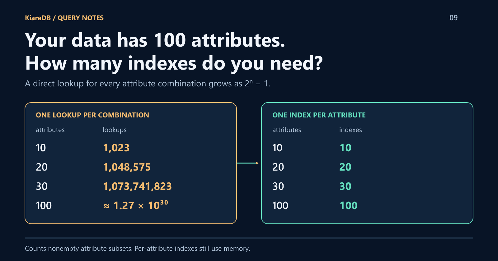

# Your Data Has 100 Attributes. How Many Indexes Do You Need?

Real records rarely have five fields. Products, trips, and configurations can carry hundreds of attributes, and every user or service filters by a different handful.
A key-value lookup is fast when you already know the key. But what is the key when it's whatever combination of attributes someone picked a moment ago?



## I kept hitting the same wall

I first ran into this problem at a global travel company, and again at a
global e-commerce company. Different domains, identical shape:

- **Many attributes.** Records carried far more fields than any screen showed.
- **Unpredictable combinations.** One request might filter by destination,
  rating, and price; the next by brand and cancellation policy. Every new
  feature invented another combination.
- **A tight budget.** The answer had to arrive inside a user-facing request,
  so a network hop to a separate search cluster was a cost of its own.
- **Data that changed rarely; questions that changed constantly.**

That last point matters. When data is read far more often than written, you
can afford to organize it once and reuse that work on every query.

## Why one lookup per combination doesn't scale

A key-value store answers `get(key)` in roughly constant time. To search by
`city`, you add a lookup keyed by city. To search by `city` **and** `stars`,
you add a lookup keyed by both. If every combination should be a direct
lookup, `n` attributes produce `2^n - 1` of them:

| Searchable attributes | Lookups needed |
|---:|---:|
| 10 | 1,023 |
| 20 | 1,048,575 |
| 30 | 1,073,741,823 |
| 100 | about 1.27 × 10^30 |

Even if queries never combine more than three of 100 attributes, that is
**166,750** lookups, each storing references to the records again and each
rebuilt whenever data changes. And each must exist **before** anyone asks.

Ordered composite indexes soften this, but they work best when a query
matches their leading columns. An index on `(city, stars, price)` does not
naturally serve a query on `price` alone.

## The obvious fix, and why it still hurts

You already know the standard answer: build **one index per attribute** and
intersect the results. That is `n` indexes instead of `2^n`.

The catch is that intersection cost follows the size of each matched list,
not the size of the answer. Imagine a million hotels, `city = Paris` matching
40% of them and `stars >= 4` matching 60%. To return a handful of results, you
still materialize and compare hundreds of thousands of record IDs.

I wanted per-attribute indexes that could be **combined without building
large ID sets**: any combination, chosen at query time, answered in memory.

That search became **KiaraDB**, first in Java and later in TypeScript.

## The idea in two sentences

KiaraDB stores records as paths in a tree, so records that share values share
nodes: near the top of the tree, all Paris hotels sit under **one** Paris
node, not a list of a million IDs. Every node also carries a pair of numbers
that tells you, with two quick comparisons, whether one node sits underneath
another. That is all you need to combine conditions.

You never declare which combinations you'll ask. You declare the fields.

## In Java

Fields become tree levels in declaration order. Put attributes with few
distinct values first and unique IDs last, so early levels share more nodes:

```java
public class Hotel {
  private String city;
  private String brand;
  private Integer stars;
  private Integer price;
  private String cancellation;
  private String id;
  // constructors, getters, and setters
}
```

Load the records, prepare once, then ask two unrelated combinations:

```java
import com.kapoorlabs.kiara.domain.Condition;
import com.kapoorlabs.kiara.domain.Operator;
import com.kapoorlabs.kiara.domain.Store;
import com.kapoorlabs.kiara.loader.StoreLoader;
import com.kapoorlabs.kiara.search.StoreSearch;
import java.util.Arrays;
import java.util.List;
import java.util.stream.Collectors;

public class HotelSearch {
  public static void main(String[] args) throws Exception {
    Store<Hotel> store = new Store<>(Hotel.class);
    StoreLoader<Hotel> loader = new StoreLoader<>(store);
    loader.loadTable(new Hotel("Paris", "Acme", 4, 180, "free", "h1"));
    loader.loadTable(new Hotel("Paris", "Zenith", 5, 320, "free", "h2"));
    loader.loadTable(new Hotel("Paris", "Acme", 3, 120, "none", "h3"));
    loader.loadTable(new Hotel("Rome", "Acme", 4, 150, "free", "h4"));
    loader.loadTable(new Hotel("Paris", "Zenith", 4, 190, "none", "h5"));
    loader.prepareForSearch();

    StoreSearch search = new StoreSearch();
    // City, rating, and price
    List<Hotel> paris = search.query(store, Arrays.asList(
        new Condition("city", "Paris"),
        new Condition("stars", Operator.GREATER_THAN_EQUAL, 4),
        new Condition("price", Operator.LESS_THAN_EQUAL, 200)));
    // A different combination: brand and cancellation policy
    List<Hotel> flexible = search.query(store, Arrays.asList(
        new Condition("brand", "Acme"),
        new Condition("cancellation", "free")));

    System.out.println(ids(paris) + " " + ids(flexible));
  }

  static List<String> ids(List<Hotel> hotels) {
    return hotels.stream().map(Hotel::getId).sorted().collect(Collectors.toList());
  }
}
```

```text
[h1, h5] [h1, h4]
```

Neither combination appears anywhere in the setup. Tomorrow's query on
`price` and `cancellation` needs no new code either.

## In TypeScript

The same model runs in Node.js or the browser:

```typescript
import {
  Store, NormalizationProfile, Operator,
  createCondition, defineSchema, textField, numberField,
} from "@kapoorlabs/kiara-ts";

interface Hotel {
  city: string; brand: string; stars: number;
  price: number; cancellation: string; id: string;
}

const store = new Store(defineSchema<Hotel>([
  textField("city"), textField("brand"), numberField("stars"),
  numberField("price"), textField("cancellation"), textField("id"),
]), { normalizationProfile: NormalizationProfile.NATIVE });

store.loadRows([
  { city: "Paris", brand: "Acme", stars: 4, price: 180, cancellation: "free", id: "h1" },
  { city: "Paris", brand: "Zenith", stars: 5, price: 320, cancellation: "free", id: "h2" },
  { city: "Paris", brand: "Acme", stars: 3, price: 120, cancellation: "none", id: "h3" },
  { city: "Rome", brand: "Acme", stars: 4, price: 150, cancellation: "free", id: "h4" },
  { city: "Paris", brand: "Zenith", stars: 4, price: 190, cancellation: "none", id: "h5" },
]);
store.prepare();

const ids = (hotels: readonly Hotel[]) => hotels.map((hotel) => hotel.id);
const paris = store.search([
  createCondition({ field: "city", values: ["Paris"] }),
  { field: "stars", operator: Operator.GREATER_THAN_EQUAL, values: [4] },
  { field: "price", operator: Operator.LESS_THAN_EQUAL, values: [200] },
]);
const flexible = store.search([
  createCondition({ field: "brand", values: ["Acme"] }),
  createCondition({ field: "cancellation", values: ["free"] }),
]);
console.log(JSON.stringify({ paris: ids(paris), flexible: ids(flexible) }));
```

```json
{"paris":["h1","h5"],"flexible":["h1","h4"]}
```

`NATIVE` keeps decimals such as `4.5` intact. Both libraries also support
multi-value fields, dates, stored ranges, typo-tolerant keyword search, and
prefix completion.

## Under the hood: the algorithm

I described the core algorithm in a 2020 paper,
[Efficient Storage and Retrieval of In-Memory Static Data](https://journal.ut.ac.ir/article_76227_7508c12200be2eb3f9f16a97aac23a44.pdf).
Think of a book's table of contents: chapter 3 spans pages 40-60, so a
section on page 45 must belong to chapter 3. KiaraDB numbers its tree the
same way.

1. **Records become paths.** Each tree level holds one attribute. Records with
   the same leading values share a path, so repeated values are stored once.
2. **A depth-first walk numbers every node** with the step it was entered and
   the step it was left. A node's descendants always fall inside its range.
3. **Each attribute gets one index** mapping a value to its tree nodes, already
   sorted by their first number.
4. **Conditions are combined by containment.** Binary-search the shorter node
   list against the longer one, keep nodes that sit inside each other, and read
   records only from the surviving paths.

Here is "Paris hotels with free cancellation," on a tree simplified to two levels:


The city index returns one node, `[1, 6]`. The cancellation index returns two,
`[2, 3]` and `[8, 9]`. Only `[2, 3]` fits inside `[1, 6]`, so h1 and h2 are
returned and Rome's path is never read. No index for "city + cancellation"
exists, and none is needed.

Per the paper, preparation is linear in records times attributes, and a
query's cost tracks how many nodes its conditions match, not how many
combinations are possible. Numeric bands and stored ranges use the same idea,
with binary search over sorted keys and interval trees.

## Is it actually faster than intersecting indexes?

I can answer that within one library. An earlier TypeScript engine kept one
index per attribute, but merged results as record-ID sets, rechecked the
candidates, and scanned numeric and range entries linearly. The current engine,
released as kiara-ts 1.2.0, uses the tree and its numbers.
Both ran on the same synthetic 100,000-record, four-attribute dataset under
Node 24, with five isolated runs per engine:

| Query (median p95) | ID-set engine | Tree engine |
|---|---:|---:|
| Two attributes combined, 2 results | 21.3 ms | 0.032 ms |
| Numeric band, 20 results | 18.9 ms | 0.045 ms |
| Stored range containing a value, 1 result | 34.9 ms | 0.011 ms |
| Broad filter, first 100 of 100,000 matches | 45.0 ms | 21.2 ms |

Selective queries dropped well below a millisecond. Broad queries improved
less, because the matching records still have to be assembled. Preparing the
data took 0.87 seconds instead of 1.31, with about 14% less memory before
text-search caches.

This compares two versions of one library on synthetic data, not every
possible index implementation or your production workload.
[The full benchmark report](https://github.com/kapoorlabs/kiara-ts/blob/v1.2.0/docs/search-execution.md)
includes the method and raw results.

## Where it fits, and where it doesn't

It fits **read-mostly data** that fits in memory, with **many attributes** and
**unpredictable combinations**: catalogs, inventories, reference data, and
layered configuration, queried inside your application process.

It is not durable storage or a transactional database. Updates work by
preparing a replacement snapshot and switching to it, which suits data that
refreshes every few minutes or hours, not thousands of writes per second.
Everything lives in RAM, so measure memory with your own records.

## Try it

- **Java:** `com.kapoorlabs:kiara` on Maven Central,
  [source on GitHub](https://github.com/kapoorlabs/kiara)
- **TypeScript:** `@kapoorlabs/kiara-ts` on npm,
  [source and the 1.2.0 tree-engine release on GitHub](https://github.com/kapoorlabs/kiara-ts)

Start with the query your current indexes make awkward: the one combining
attributes nobody planned for.
