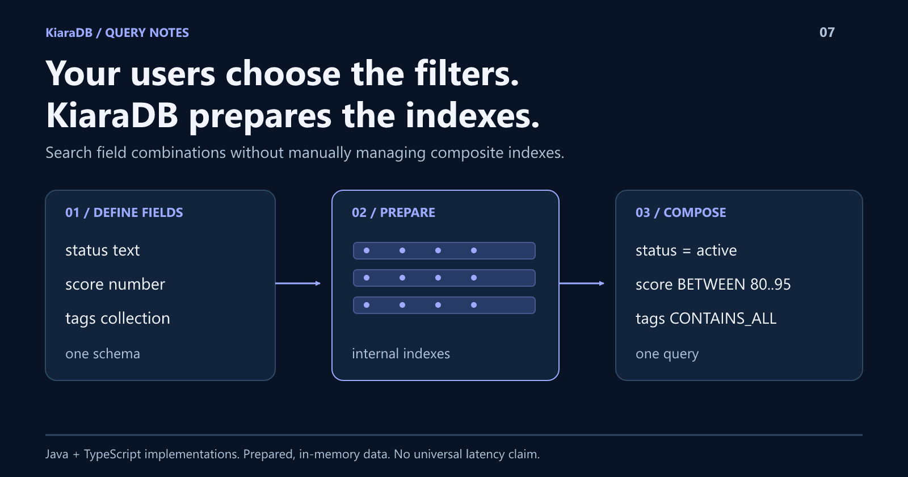

# Search Any Field Combination Without Managing Composite Indexes

Your users choose the next filter combination. You should not have to design a composite index for each one.
KiaraDB prepares searchable fields once, then lets you combine equality, numeric bounds, collection requirements, and stored-range queries.
This walkthrough shows what automatic indexing removes from application code, what advanced filters make possible, and which responsibilities remain yours.



## The interesting problem is changing questions

A search interface might start with a status filter. Later, users want a score
band, two required tags, an excluded value, and a point inside a stored interval.

The query shapes multiply even though the underlying records have barely changed.
Hand-written filtering branches become difficult to maintain; manually planned
indexes can become another design concern.

This is not a claim that other databases need an index for every query.
PostgreSQL, for example, supports [combining multiple indexes](https://www.postgresql.org/docs/current/indexes-bitmap-scans.html)
and documents [multicolumn index trade-offs](https://www.postgresql.org/docs/current/indexes-multicolumn.html).
The question is whether KiaraDB's preparation model reduces setup for your workload.

KiaraDB's useful proposition is **search over combinations of declared fields
without manually defining a composite index for each combination**.

It has Java and TypeScript implementations. That makes the idea relevant to
services and applications in different stacks, not just browser interfaces.
This article demonstrates the TypeScript library; it does not assume identical
APIs in Java.

## Automatic indexing is not index-free storage

In the TypeScript library, you define field types, load records, and call
`prepare()`. Preparation creates internal per-field indexes and a trie
representation. Fields are searchable unless excluded with `ignoreIndex`.

The application does not issue a separate index-creation command for each
combination of conditions.

That distinction matters. KiaraDB still needs a schema, normalization, preparation
time, and memory for records and indexes. It cannot search undeclared properties
or make every workload independent of dataset size.

The Java project documents a trie-based, read-oriented model with shared-prefix
deduplication. The TypeScript implementation also maintains per-field indexes;
do not assume the two engines share identical internals or memory behavior.

## Define once, ask different questions

Install the tested package with `npm install @kapoorlabs/kiara-ts@1.1.0`.
Save this JavaScript as `combined-search.mjs`, then run
`node combined-search.mjs`. No TypeScript compilation is needed.

The three fictional records make the behavior easy to inspect. They are not
evidence of throughput or scale.

```javascript
import {
  Store, NormalizationProfile, Operator,
  createCondition, defineSchema, textField, numberField,
} from "@kapoorlabs/kiara-ts";

const store = new Store(defineSchema([
  textField("id", { ignoreIndex: true }),
  textField("status", { caseInsensitive: true }),
  numberField("score"),
  textField("tags", { secondaryType: "commaSeparatedStrings" }),
  textField("window", { secondaryType: "numericRange" }),
]), { normalizationProfile: NormalizationProfile.NATIVE });
store.loadRows([
  { id: "a", status: "active", score: 85, tags: "audited,export", window: "10->30" },
  { id: "b", status: "active", score: 92, tags: "export", window: "10->30" },
  { id: "c", status: "archived", score: 98, tags: "audited,export", window: "10->30" },
]);
store.prepare();

const status = createCondition({ field: "status", values: ["ACTIVE"] });
const combined = [
  status,
  { field: "score", operator: Operator.BETWEEN, lowerValue: 80, upperValue: 95 },
  { field: "tags", operator: Operator.CONTAINS_ALL, values: ["audited", "export"] },
  { field: "window", operator: Operator.CONTAINS_EITHER, values: [20] },
];
console.log(JSON.stringify({
  byStatus: store.search([status]).map((row) => row.id),
  combined: store.searchProjection(combined, ["id", "score"]),
}));
```

Expected output:

```json
{"byStatus":["a","b"],"combined":[{"id":"a","score":85}]}
```

The second query adds three requirements to the first. No new index definition,
per-combination store, or custom tag parser appears between the searches.

The ID is excluded from filtering but still available in the typed projection.
That is an indexing choice, not an authorization boundary.

## The less obvious capabilities

Basic equality is only the starting point:

| Requirement | Capability |
|---|---|
| Require every selected tag, or just one | Collection ALL and ANY operators |
| Exclude a member | `NOT_CONTAINS`, rather than substring matching |
| Query a supported date or date-time | Typed temporal normalization and comparisons |
| Match a point inside a stored window | Numeric, date, and date-time range containment |
| Represent several allowed windows | Collections of ranges without expanding every point into a row |
| Accept incomplete source data deliberately | Explicit scalar null and supported null-aware collection queries |
| Return only what the caller needs | Typed projections and result limits |

Operators have field-specific semantics. In particular, containing two points
in separate intervals does not prove coverage of the gap between them.

The TypeScript schema can describe text, numbers, longs, booleans, and enums.
Use schema builders for plain records, or standard TypeScript decorators for
annotated models. Both feed the same TS engine.

## Help users express the query

The TypeScript 1.1.0 `QueryInterpreter` adds another useful layer. It can
discover whole values across eligible fields, resolve declared aliases, convert
configured units, and turn explicit expressions into conditions.

If a value belongs to several fields, interpretation exposes ambiguity instead
of choosing one silently. Strict execution rejects unresolved fragments.

Separately, keyword retrieval supports English stemming and one-edit typo
correction alongside hard filters. Dictionary prefix suggestions help users
complete words; record retrieval remains a separate operation.

These are inspectable, deterministic tools, not unrestricted natural-language
understanding. Nor should the TypeScript interpreter be presented as an API
verified in the Java implementation.

## What the design asks you to trade

KiaraDB is a fit to evaluate for read-mostly, prepared datasets. Preparation is
not free, and the data and search structures must fit your memory budget.

Measure loading, preparation, memory, query latency, and returned-row counts
separately. Automatic indexing does not establish constant-time searches or
prove superiority to a database you already use.

For a tiny list and one condition, a loop may be simpler. For transactional
writes, joins, durable storage, or access control, retain systems designed for
those responsibilities.

TypeScript `StoreLoader.replaceAll` can prepare a replacement while retaining
the previous store. Your application validates it and controls activation.
Worker APIs are available when browser execution needs to leave the UI thread;
workers are an integration option, not the product's defining identity.

The TS package has zero runtime dependencies of its own. The example playground
has separate UI and CSV dependencies, which should not be confused with the
library's footprint.

## Evaluate the combination, not a slogan

The meaningful test is to take one real dataset and add the filter combination
your current interface makes awkward.

Can you express it as conditions? Can you inspect the results? What changes
when you add another field? The answers tell you more than a universal
performance headline would.

Try your own CSV and the guided queries in the
[companion playground](https://github.com/kapoor-labs/kiara-ts-examples),
which links to the Java and TypeScript libraries.
