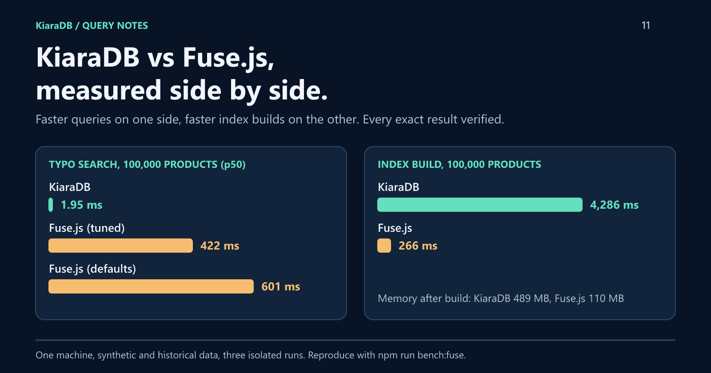

# KiaraDB vs Fuse.js: Faster Queries or Faster Builds? A Side-by-Side Benchmark

Fuse.js is a popular fuzzy-search library for JavaScript. KiaraDB is a newer in-memory search engine for TypeScript and Java that indexes every field before the first query.
A benchmark over five datasets shows a clear trade-off: KiaraDB answered every query both libraries could run faster, while Fuse.js built its index 11 to 25 times faster, used far less memory, and matched text more flexibly.



*Disclosure: the author of this article created KiaraDB, and the draft was prepared with AI assistance. Every number comes from the open benchmark linked at the end, which anyone can rerun.*

## Two different designs

**Fuse.js** needs almost no preparation. At search time it scores every record with approximate string matching, so it tolerates several typos, matches parts of words, and ranks by relevance.

**KiaraDB** asks for a schema and builds one index per field up front. Queries combine those indexes, so any mix of fields, numbers, dates, lists, and stored ranges works without a composite index. Its text search corrects one typo per word against the indexed words.

Fuse.js does its work during the search; KiaraDB does most of it before.

## The same query in both libraries

Both can combine exact filters with a misspelled title search:

```javascript
import Fuse from "fuse.js";
import {
  Store, NormalizationProfile, KeywordSearch, createCondition, defineSchema, textField,
} from "@kapoorlabs/kiara-ts";

const products = [
  { status: "active", region: "emea", title: "Wireless Desk Lamp", id: "p1" },
  { status: "active", region: "amer", title: "Wireless Floor Lamp", id: "p2" },
  { status: "archived", region: "emea", title: "Wired Desk Lamp", id: "p3" },
  { status: "active", region: "emea", title: "Ceramic Coffee Mug", id: "p4" },
];

// Fuse.js: no preparation step. Exact matches use extended search; "wireles" is fuzzy.
const fuse = new Fuse(products, { keys: ["status", "region", "title"], useExtendedSearch: true });
const fuseIds = fuse
  .search({ $and: [{ status: '="active"' }, { region: '="emea"' }, { title: "wireles" }] })
  .map((result) => result.item.id);

// KiaraDB: declare fields and prepare once; filters and the corrected keyword then combine.
const store = new Store(defineSchema([
  textField("status", { caseInsensitive: true }),
  textField("region", { caseInsensitive: true }),
  textField("title", { caseInsensitive: true }),
  textField("id", { ignoreIndex: true }),
]), { normalizationProfile: NormalizationProfile.NATIVE });
store.loadRows(products);
store.prepare();
const kiaraIds = new KeywordSearch(store).bestMatch("wireles", {
  fields: ["title"],
  conditions: [
    createCondition({ field: "status", values: ["active"] }),
    createCondition({ field: "region", values: ["emea"] }),
  ],
}).results.map((product) => product.id);

console.log(JSON.stringify({ fuseIds, kiaraIds }));
```

```json
{"fuseIds":["p1"],"kiaraIds":["p1"]}
```

Both find the same lamp. The benchmark measures what each approach costs at scale.

## How the benchmark was run

- **Five datasets:** 3,788 real retail products, plus synthetic product catalogs and event schedules of 10,000 and 100,000 records.
- **92 exact scenarios,** each checked against an independent plain-JavaScript implementation. A wrong or missing record fails the run; both libraries passed every scenario they ran.
- **Fuse.js 7.5.0, twice:** defaults, and tuned with `ignoreLocation` and word-by-word matching. It ran the 26 exact scenarios it can express, plus the text searches.
- **Text results** rank differently, so each text timing sits next to a simple relevance score.
- **Three isolated Node.js processes** per library and dataset, reporting median latency.

## Query latency

Median latency at 100,000 records:

| Scenario | KiaraDB | Fuse.js defaults | Fuse.js tuned |
|---|---:|---:|---:|
| Typo search "wireles lamp", top 10 | 1.95 ms | 601 ms | 422 ms |
| Stemmed search "chargers", top 10 | 1.0 ms | 363 ms | 385 ms |
| Typo search with two filters, top 10 | 26.6 ms | 104 ms | 115 ms |
| Three fields equal (299 matches) | 0.37 ms | 47 ms | 49 ms |
| One date equal (292 matches) | 0.28 ms | 45 ms | 46 ms |
| Two broad fields equal (17,605 matches) | 39.5 ms | 52.5 ms | 52.9 ms |

KiaraDB was faster in all 26 shared exact scenarios, but the margin ranged from 1.3× to 515×. It was widest for selective conditions and short result lists, and narrowest when conditions matched many records: joining two large per-field indexes costs almost as much as scoring every record. The same effect cut the filtered typo search to about 4×.

The other 66 exact scenarios need features Fuse.js does not express exactly, such as numeric and date comparisons, stored ranges, missing-value tests, and exclusions. That count reflects KiaraDB's feature set more than performance.

## Build time and memory

| Dataset | Build: KiaraDB / Fuse.js | Memory: KiaraDB / Fuse.js |
|---|---:|---:|
| Retail, 3,788 | 338 / 24 ms | 14.6 / 4.3 MB |
| Catalog, 10,000 | 520 / 47 ms | 53 / 11 MB |
| Catalog, 100,000 | 4,286 / 266 ms | 489 / 110 MB |
| Schedule, 10,000 | 749 / 35 ms | 93 / 10 MB |
| Schedule, 100,000 | 7,513 / 299 ms | 871 / 101 MB |

Fuse.js is clearly ahead here. KiaraDB's per-field indexes take seconds to build at 100,000 records and use three to nine times the memory. KiaraDB also cannot add or remove a single record; changes mean rebuilding a snapshot, while Fuse.js updates its index in place.

## Result quality

Neither library won every quality check:

- **Fuse.js depends on configuration.** With defaults, none of its top 10 results for `wireles lamp` contained both words; the tuned configuration got all 10 right.
- **KiaraDB's correction can pick the wrong word.** It chooses the alphabetically first one-edit match, so on the retail data `holdr` became `hldr`, an abbreviation in the source. One of its 10 results was relevant, against 8 and 10 for Fuse.js.
- **Result lists differ.** KiaraDB returns only records that match after correction. Fuse.js fills the list with the nearest matches: with filters on 10,000 records it returned 10 results, 3 relevant, while KiaraDB returned 3, all relevant.

## Features only one library has

**Only Fuse.js:** several typos per word, swapped letters, partial words, matching inside words, accent folding, relevance scores, weighted fields, highlighting, custom tokenizers, OR across fields, in-place updates, saved indexes, nested fields, and Web Workers.

**Only KiaraDB:** numeric and date comparisons, stored ranges such as availability windows, missing-value tests, exclusions, minimum-match keyword search, reported spelling corrections, and a query interpreter that turns `active emea` into field conditions.

## Where each fits

- **Fuse.js** suits free text typed by people, where typos and partial words are common; frequently changing data; fast startup and low memory; and interfaces that need scores or highlighting.
- **KiaraDB** suits many structured fields combined unpredictably, numeric, date, and range filters, and tight latency budgets over large, read-mostly data refreshed as snapshots.

The two also combine: KiaraDB applies structured filters, and Fuse.js ranks the remaining titles.

## Limits of this comparison

The results come from one machine, with mostly synthetic data. KiaraDB's author designed the scenarios, so they explore KiaraDB's features more deeply than Fuse.js's, and the relevance score is deliberately simple. KiaraDB was measured on [kiara-ts 1.2.0](https://github.com/kapoorlabs/kiara-ts/releases/tag/v1.2.0); the example above also runs on 1.1.0 from npm.

## Reproduce it

```bash
git clone https://github.com/kapoor-labs/kiara-ts-examples
cd kiara-ts-examples && npm install && npm run bench:fuse
```

The [full report](https://github.com/kapoor-labs/kiara-ts-examples/blob/main/docs/fuse-comparison.md) lists every scenario, the feature comparison, and the method. Both libraries are open source: [Fuse.js](https://github.com/krisk/Fuse), and KiaraDB for [TypeScript](https://github.com/kapoorlabs/kiara-ts) and [Java](https://github.com/kapoorlabs/kiara).
