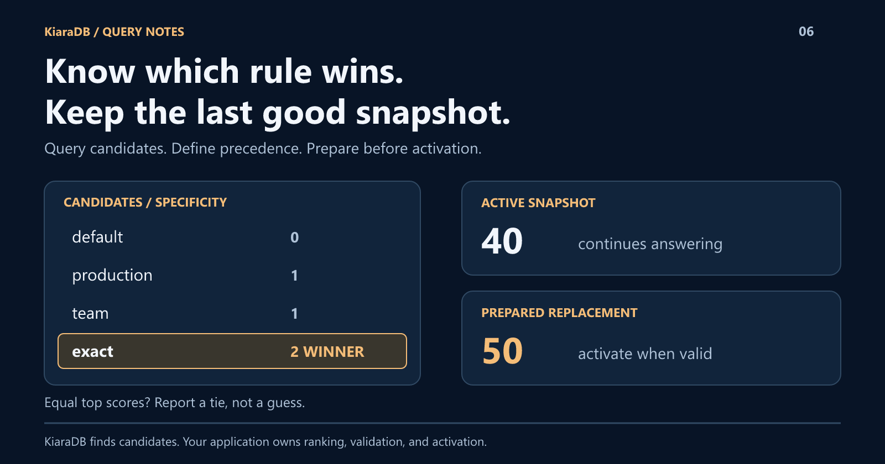

# Which Rule Won? Query, Explain, and Refresh Configuration with KiaraDB

A default, two overrides, and one exception: which setting should apply?
If the answer depends on row order, your configuration has an invisible policy.
KiaraDB can retrieve applicable rules; a small application layer can expose precedence, report ties, and activate prepared replacements.
Here is how to make the decision explainable without hiding business rules inside a keyword score.



## Separate matching from policy

Consider two matching dimensions: environment and group. In this example,
`null` means "any value," and the payload is a numeric setting.

| Rule | Environment | Group | Value |
|---|---|---|---:|
| default | null | null | 10 |
| production | prod | null | 20 |
| team | null | alpha | 30 |
| exact | prod | alpha | 40 |

For `prod / alpha`, every rule applies. That does not mean every rule should win.

KiaraDB retrieves candidates using structured conditions. The application counts
non-null matching dimensions and requires a unique top score. Wildcards and
precedence are application conventions, not hidden database features.

## Run the decision, including the tie

Install `@kapoorlabs/kiara-ts@1.1.0`, save this as `rules.mjs`, and run
`node rules.mjs`. These are fictional rules to illustrate policy, not defaults
your application should inherit.

The same decisions were verified on **1.1.1-search.0**, the optimized candidate
behind [1.2.0 on GitHub](https://github.com/kapoorlabs/kiara-ts/releases/tag/v1.2.0).
Its release notes report npm publication blocked; the install stays at 1.1.0.
Faster candidate retrieval does not change the application's precedence policy.

```javascript
import {
  Store, StoreLoader, NormalizationProfile,
  createCondition, defineSchema, textField, numberField,
} from "@kapoorlabs/kiara-ts";

const rows = [
  { id: "default", environment: null, group: null, value: 10 },
  { id: "production", environment: "prod", group: null, value: 20 },
  { id: "team", environment: null, group: "alpha", value: 30 },
  { id: "exact", environment: "prod", group: "alpha", value: 40 },
];
let active = new Store(defineSchema([
  textField("id", { ignoreIndex: true }),
  textField("environment", { nullable: true }),
  textField("group", { nullable: true }),
  numberField("value", { ignoreIndex: true }),
]), { normalizationProfile: NormalizationProfile.NATIVE });
active.loadRows(rows);
active.prepare();

function resolve(store) {
  const candidates = store.search([
    createCondition({ field: "environment", values: ["prod", null] }),
    createCondition({ field: "group", values: ["alpha", null] }),
  ]).map((rule) => ({
    rule,
    score: ["environment", "group"].filter((field) => rule[field] !== null).length,
  }));
  if (!candidates.length) return { status: "no-match" };
  const highest = Math.max(...candidates.map((item) => item.score));
  const top = candidates.filter((item) => item.score === highest);
  return top.length === 1
    ? { status: "matched", id: top[0].rule.id, value: top[0].rule.value }
    : { status: "ambiguous" };
}

function replaceRules(proposed) {
  if (proposed.some((rule) => !Number.isFinite(rule.value) || rule.value < 0)) {
    throw new RangeError("Values must be finite and nonnegative.");
  }
  const next = new StoreLoader(active).replaceAll(proposed);
  active = next;
}

const first = resolve(active);
const tied = new StoreLoader(active).replaceAll(rows.filter((row) => row.id !== "exact"));
let rejection;
try {
  replaceRules([{ ...rows[0], value: -1 }]);
} catch (error) {
  if (!(error instanceof RangeError)) throw error;
  rejection = error.message;
}
const afterRejected = resolve(active);
const previous = active;
replaceRules(rows.map((row) => row.id === "exact" ? { ...row, value: 50 } : row));

console.log(JSON.stringify({
  first, tie: resolve(tied).status, rejection,
  retained: afterRejected.value,
  updated: resolve(active).value,
  previous: resolve(previous).value,
}));
```

Expected output:

```json
{"first":{"status":"matched","id":"exact","value":40},"tie":"ambiguous","rejection":"Values must be finite and nonnegative.","retained":40,"updated":50,"previous":40}
```

## Make disagreement a visible outcome

Remove the exact rule and the remaining two overrides both score one.
Returning `ambiguous` is more honest than using input order as an accidental
tie-breaker.

This scoring policy weights both dimensions equally. If environment should
outrank group, encode that rule explicitly and test it.

Production responses should include the candidate trace and active revision.
The companion application does; the short example prints only the outcomes.

Do not substitute TypeScript `KeywordSearch.minimumMatch` for this resolver.
It selects a lowest positive token-match group, not business-rule specificity.

## Keep the previous snapshot until the replacement is ready

`StoreLoader.replaceAll` returns a distinct prepared store. Only then does
`replaceRules` update the active reference.

The rejected update leaves the current answer unchanged. A successful update
changes the active answer, but existing references still represent the previous
snapshot.

That is useful for more than configuration: it also fits refreshed lookup tables
and other read-mostly datasets. It is not a distributed transaction or durable
version history.

If your application binds an interpreter to the store, rebuild that interpreter
for the new snapshot before activating the pair.

## What production still needs

The example validates numeric payloads. Real publication paths should additionally
validate complete record shapes, unique IDs, matching dimensions, and the intended
policy for empty configurations.

Add authorization, durable version storage, audit history, rollback, and
cross-instance rollout where required. Missing context should match only
wildcards, not specific rules for a value you were never given.

Rule IDs and payloads can remain projection-only fields: they help explain
the outcome without influencing candidate retrieval.

## The payoff is an answer you can explain

KiaraDB supplies candidate search and prepared-store replacement. Your
application supplies the policy.

Keeping that boundary explicit makes it possible to answer both "what applies?"
and "why?" without building another opaque branch tree.

Try **Runtime configuration** in the
[companion playground](https://github.com/kapoor-labs/kiara-ts-examples) to inspect
candidate traces, ties, revisions, and rejected replacements interactively.
