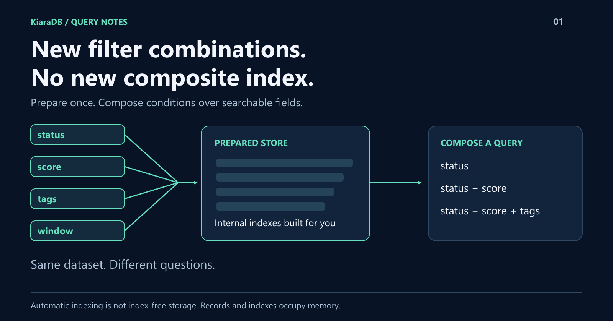

# New Filter Combination? You Shouldn't Need a New Index.

Today users filter by status. Tomorrow they add a score, two tags, and a date window.
KiaraDB lets you combine searchable fields without manually designing a composite index for each combination.
Define the fields, load the records, prepare once.
Here is what that buys you beyond another search box.



## Change the question, not the index definition

Imagine these requests against the same records:

- Status is active.
- Status is active **and** score is at least 80.
- Both conditions, plus **all** selected tags.

With KiaraDB, your application composes conditions over the prepared store.
It does not hand-build an index for each of those combinations.

**Automatic indexing is the feature. "No indexes" is not the claim.**
You still define a schema, and the records and indexes occupy memory.

## Go beyond equality

The same query layer supports requirements that are awkward to express as
ordinary text search:

- **Numbers:** exclusive bounds, inclusive bounds, and inclusive ranges.
- **Collections:** require ALL members, accept ANY, or exclude selected members.
- **Stored intervals:** find records whose numeric or date range contains a point.
- **Text plus filters:** recover from a typo without relaxing an exact condition.
- **Projection:** return the fields the caller needs, with their types preserved.

These are different questions, not five renamed dropdowns.

## Give users another way to ask

The TypeScript library's optional interpreter can turn:

```text
status:active score>=80
```

into inspectable conditions. It can also discover whole values across eligible
fields, resolve declared aliases, and flag ambiguity instead of guessing.

That means less time navigating a filter panel and more visibility into what
the query actually means.

## Where to start

KiaraDB has Java and TypeScript implementations. The shared opportunity is
read-oriented querying over prepared data, not a browser-only database pitch.
The TypeScript package also has no runtime dependencies of its own.

For high-frequency transactional writes or durable storage, keep the system
responsible for those jobs. For changing combinations of filters over a
read-mostly dataset, this is worth trying.

**Bring your most awkward filter combination.**
Use **Bring your own CSV** or the guided queries in the
[KiaraDB playground](https://github.com/kapoor-labs/kiara-ts-examples) to see how
much can be expressed as conditions instead of custom filtering code.
