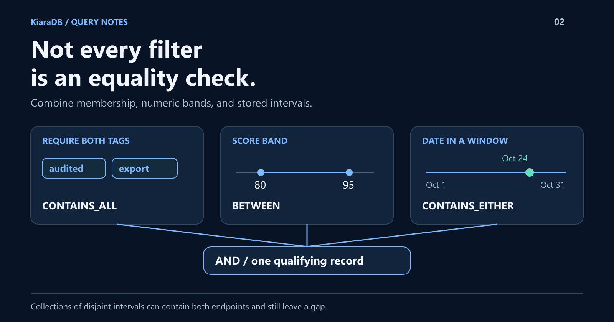

# Tags, Dates, and Ranges: Build Richer Filters with KiaraDB

"Has both tags, scores between 80 and 95, and covers this date."
That is one request, but three different kinds of matching.
KiaraDB lets you combine them as structured conditions over a prepared dataset.
In this walkthrough, you will build that query, return only the fields you need, and avoid two easy mistakes: substring matching and false interval coverage.



## Start with the requirement, not a string parser

A score is a number. Tags are a collection. A date window is an interval.
Treating all three as text loses their meaning.

KiaraDB's TypeScript library gives each a representation and compatible operators.
Preparation builds internal indexes for the declared searchable fields; there
is no separate composite-index declaration for this particular combination.

The example below runs through JavaScript without compilation. Its output was
verified on **1.1.0** and the optimized **1.1.1-search.0** candidate behind
[the 1.2.0 release](https://github.com/kapoorlabs/kiara-ts/releases/tag/v1.2.0).
That release's notes report npm publication blocked, so the install below stays
pinned to 1.1.0. The three records are teaching data, not a benchmark.

## One query, three matching rules

Install `@kapoorlabs/kiara-ts@1.1.0`, save this as `advanced-filters.mjs`,
and run `node advanced-filters.mjs`.

```javascript
import {
  Store, NormalizationProfile, Operator,
  defineSchema, textField, numberField,
} from "@kapoorlabs/kiara-ts";

const store = new Store(defineSchema([
  textField("id", { ignoreIndex: true }),
  numberField("score"),
  textField("tags", { secondaryType: "commaSeparatedStrings" }),
  textField("window", { secondaryType: "dateRange" }),
]), { normalizationProfile: NormalizationProfile.NATIVE });

store.loadRows([
  { id: "a", score: 85, tags: "audited,export", window: "2026-10-01->2026-10-31" },
  { id: "b", score: 90, tags: "export", window: "2026-10-01->2026-10-31" },
  { id: "c", score: 90, tags: "audited,export", window: "2026-11-01->2026-11-30" },
]);
store.prepare();

const conditions = [
  { field: "score", operator: Operator.BETWEEN, lowerValue: 80, upperValue: 95 },
  { field: "tags", operator: Operator.CONTAINS_ALL, values: ["audited", "export"] },
  { field: "window", operator: Operator.CONTAINS_EITHER, values: ["2026-10-24"] },
];
console.log(JSON.stringify(store.searchProjection(conditions, ["id", "score"])));
```

Expected output:

```json
[{"id":"a","score":85}]
```

Record `b` lacks a required tag. Record `c` does not cover the requested date.
Record `a` meets all three conditions. The projected score stays numeric, and
the ignored-index ID can still be returned.

## ALL, ANY, and NOT are different requirements

Switch `CONTAINS_ALL` to `CONTAINS_EITHER` on tags and `b` also qualifies.
Use `NOT_CONTAINS` when a selected member must be absent.

These operators inspect members, not character sequences. A tag named `export`
should not accidentally match `no-export` merely because the text overlaps.
Collection inequality also differs from membership exclusion: comparing a whole
collection key is not the same as excluding one of its members.

Conditions are ANDed. Alternatives inside a scalar equality condition can
accept several values for that field. This is composable filtering, not an
unrestricted Boolean-expression language.

## Dates and ranges are not the same thing

Use scalar date/date-time fields when the record stores a moment. Use stored
ranges when the record describes an interval.

The library supports numeric, date, and date-time ranges, plus collections of
those ranges. Collections of strings, numbers, dates, and date-times are also
available: **12 secondary field types**, exercised by the playground's tests.

There is an important distinction:

- One interval containing both requested endpoints covers the space between them.
- Two separate intervals can contain those endpoints while leaving a gap.

Therefore, "all requested points are contained" does not prove continuous coverage
across a collection of disjoint windows.

Prefix-aware numeric ranges are another specialized option: `numericStartPos`
can preserve a namespace such as `Y` while matching the numeric part.

## Make missing data an explicit choice

Scalar equality with `null` searches for missing values. For supported
collections, `CONTAINS_EITHER_INCLUDING_NULL` can accept either a selected member
or a null collection.

That is a policy choice, not permission to invent a default. Range types do not
support that special null operator.

Configure case handling and supported date formats deliberately. Use NATIVE
normalization when decimal values must retain their fractional part.

## Build the query your data deserves

KiaraDB's advantage here is not that a comparison operator exists. It is that
several kinds of requirements compose over the same prepared data.

For a tiny list and one predicate, a simple loop may suffice. When filters span
sets, quantities, and windows, preserving those meanings makes the code easier
to reason about.

Try the **44 guided queries** in the
[companion playground](https://github.com/kapoor-labs/kiara-ts-examples).
They cover these operators and field families against pinned datasets, including
explicitly labeled derived date/range helpers.
